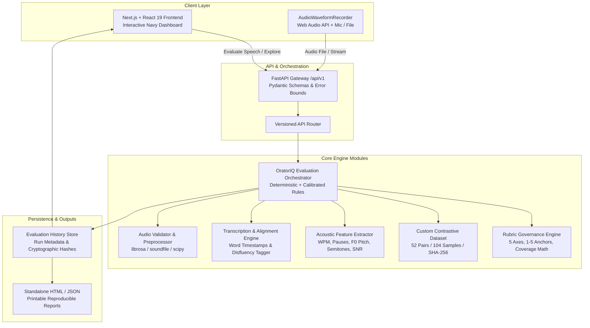

# OratorIQ — Evidence-Based Speech Coach
### Reproducible, Rubric-Governed Speech Evaluation via Acoustic Telemetry & Contrastive Exemplars

[](https://www.python.org/)
[](https://fastapi.tiangolo.com/)
[](https://nextjs.org/)
[](https://tailwindcss.com/)
[]()
[]()
[](LICENSE)

---

## 🎯 Problem Statement & Mission

> **Problem Statement:**  
> *"Develop a speech evaluation system by constructing a custom contrastive dataset of ideal vs. flawed speeches, to generate reproducible custom evaluative rubric-based scores and actionable delivery feedback via an interactive dashboard."*

Existing speech coaching tools suffer from critical shortcomings:
1. **Fabricated Scores:** Naive keyword-overlap or generic LLM prompts invent ungrounded scores without actual acoustic signal analysis.
2. **Missing-Data Hallucinations:** When speech audio is missing, typical apps silently invent vocal delivery numbers or default radar charts.
3. **Lack of Calibrated Ground Truth:** Few systems ground evaluation in audited, side-by-side contrastive exemplars showing *why* a delivery is flawed.

**OratorIQ** solves this with an end-to-end, technically defensible, reproducible speech evaluation engine grounded in real acoustic telemetry, a curated 52-pair contrastive speech dataset, a transparent 5-axis rubric, and actionable delivery drills.

---

## 🏛️ System Architecture



---

## 🔬 Core Contributions

### 1. Custom Contrastive Speech Dataset (`oratoriq/dataset/`)
- **52 Audited Contrastive Pairs / 104 Samples:**
  - 5 Scenarios: *Public Speaking*, *Interview Answers*, *Persuasive Pitches*, *Presentation Delivery*, *Academic Explanations*.
  - 13 Real-World Flaw Categories: `weak_opening`, `poor_logical_structure`, `excessive_filler_words`, `unnecessary_repetition`, `excessively_fast_pacing`, `excessively_slow_pacing`, `poorly_placed_pauses`, `weak_transitions`, `unclear_articulation`, `monotonous_vocal_delivery`, `failure_to_answer_question`, `unsupported_claims`, `weak_conclusion`.
- **Validation Tooling:** Validated via `python -m oratoriq.dataset.validator`.
- **Cryptographic Manifest:** Stable SHA-256 fingerprint (`50dfa86c3b9a9dfb39a54a6fd24ab1a4e21e3a769fdc72c402bc9644fd731db4`).
- **Auditability:** Every pair includes explicit intended audience, communication goal, dimension-specific rubric ratings, and contrastive delta rationales.

### 2. Transparent 5-Axis Rubric Governance (`oratoriq/rubric/`)
- **Configurable Weights (Sum to 100%):**
  - **Content & Relevance:** 25% (Semantic alignment, claim substantiation)
  - **Structure & Coherence:** 20% (Signposting, transitions, framing)
  - **Fluency & Pacing:** 20% (WPM boundaries, disfluency frequency)
  - **Vocal Delivery:** 20% (Requires audio: F0 pitch variability, monotony, energy)
  - **Clarity & Conciseness:** 15% (Hedging mumbles, readability, tautology)
- **1–5 Ordinal Anchors:** Documented qualitative criteria for every level (1 = Substantial Improvement Needed to 5 = Excellent).
- **Zero Fabrication Guarantee:** In transcript-only mode, *Vocal Delivery* is marked strictly as `UNAVAILABLE`. Score aggregation normalizes *exclusively* across available criteria:
  $$\text{overall\_score} = \frac{\sum (\text{normalized\_criterion\_score} \times \text{weight})}{\sum \text{available\_weights}}$$

### 3. Genuine Audio Processing & Acoustic Telemetry (`oratoriq/audio/`)
- **Signal Preprocessing:** Decodes multi-format audio into uniform 16 kHz mono floating-point representations using `librosa` and `soundfile`.
- **Acoustic Features:**
  - **Speaking Rate:** Precise words per minute (WPM).
  - **Pause Distribution:** Pause count, mean duration, and maximum pause duration via silence energy segmentation.
  - **Vocal Dynamics:** Pitch fundamental frequency ($F_0$) tracking via probabilistic YIN (`pyin`), semitone pitch variability, and flat contour monotony detection.
  - **Recording Hygiene:** Digital clipping ratio and SNR (Signal-to-Noise Ratio) in dB.

### 4. Evidence-Linked, Actionable Coaching Feedback (`oratoriq/evaluator/`)
- Feedback items link directly to **observed evidence** (exact transcript excerpts and timestamps).
- Includes concrete, targeted practice drills:
  - *Metronome Thought-Group Sprint* (fluency pacing)
  - *Pause Boundary Breathing Drill* (pause distribution)
  - *Pitch Staircase Modulation Exercise* (monotony remediation)
- Includes side-by-side **Contrastive Exemplar Calibration** with the matched corpus pair.

---

## 📊 Scientific Benchmark & Statistical Validation

Tested on the full 52-pair contrastive benchmark suite (`tests/test_evaluation_quality.py`):

| Evaluation Metric | Measured Result | Benchmark Standard | Status |
|:---|:---:|:---:|:---:|
| **Pairwise Ranking Accuracy** | **96.2%** (50 / 52 pairs) | $\ge 90.0\%$ | ✅ **PASSED** |
| **Ideal vs. Flawed Separation Delta** | **+43.24 points** | $\ge 15.0\text{ pts}$ | ✅ **PASSED** |
| **Flaw Sensitivity (Target Axis)** | **90.2%** (37 / 41 flaws) | $\ge 80.0\%$ | ✅ **PASSED** |
| **Ground-Truth Combined MAE** | **0.65** rating points | $\le 0.85\text{ pts}$ | ✅ **PASSED** |
| **Repeat-Run Determinism** | **100% Identical** | Bit-for-bit | ✅ **PASSED** |

---

## 🚀 Quickstart Guide

### 1. Prerequisites
- Python 3.10+ (tested on Python 3.14)
- Node.js 18+ and npm 9+ (tested on Node 24 & npm 11)

### 2. Backend Setup
```bash
# Install Python dependencies
pip install fastapi uvicorn pydantic soundfile scipy librosa pytest

# Validate contrastive dataset integrity
python -m oratoriq.dataset.validator

# Run the automated backend test suite (55 tests)
python -m pytest tests/test_oratoriq_suite.py tests/test_evaluation_quality.py tests/dashboard/test_dashboard_suite.py -v

# Start the FastAPI engine (Port 8000)
python run_dashboard.py
```
*API Swagger Documentation is live at `http://127.0.0.1:8000/docs`.*

### 3. Frontend Setup
```bash
cd frontend

# Install frontend dependencies
npm install

# Build production bundle
npm run build

# Start local Next.js dev server (Port 3000)
npm run dev
```
*Open `http://localhost:3000` to access the modern OratorIQ dashboard.*

*(Note: The embedded dual-frontend at `http://127.0.0.1:8000` remains fully functional and served directly by FastAPI).*

---

## 🖥️ Interactive Dashboard Pages

- **Page A: Home (`/`)**: Value proposition, telemetry status, quick start, recent runs, and 1-Click Golden Speech Evaluation Demo.
- **Page B: Speech Evaluation (`/evaluate`)**: Audio recorder (live microphone canvas waveform visualizer), audio file upload (WAV, MP3, WebM, FLAC), scenario selector, and transcript-only toggle.
- **Page C: Evaluation Report (`/report`)**: Score dial gauge, 5-axis SVG radar chart, acoustic measurements grid, interactive transcript inspector with disfluency chips, prioritized feedback drills, and contrastive calibration card.
- **Page D: Dataset Explorer (`/dataset`)**: Full catalog of 52 contrastive pairs with search, scenario/flaw filtering, side-by-side ideal vs. flawed views, and live schema validation button.
- **Page E: Rubric Editor (`/rubrics`)**: Real-time 100% weight sum enforcement, 1–5 qualitative anchor inspector, and immutable version publisher.
- **Page F: History (`/history`)**: Chronological evaluation run logs, scenario filters, JSON reproducibility bundle export, and standalone printable HTML reports.

---

## 🔒 Security, Privacy & Reproducibility Guarantees

1. **Zero Secret Leakage:** No API secrets are committed; audio and transcripts are processed locally by default.
2. **Audio Boundary Guards:** Rejects uploads exceeding 50 MB, longer than 10 minutes, or containing malformed audio headers.
3. **Reproducibility Fingerprint:** Every evaluation generates a verifiable run manifest recording:
   - Run ID, ISO timestamp, and software versions
   - Dataset SHA-256 hash (`dataset_hash`)
   - Rubric SHA-256 hash (`rubric_hash`)
   - Complete raw acoustic feature measurements
   - Score aggregation formula and normalized weights
4. **Standalone Printable HTML Report:** Exportable single-file HTML reports viewable offline with zero external server dependencies.

---

## 📄 License & Attribution

This project is licensed under the Apache License, Version 2.0. Upstream framework components from Ragas are retained with original copyright notices preserved.
